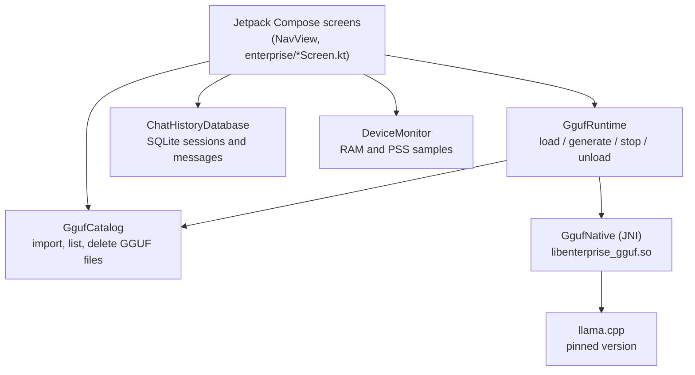

# Architecture

## Overview

## Layers

**UI (Kotlin, Jetpack Compose, Navigation).** `NavView` defines the routes: dashboard, GGUF manager,
GGUF inference, live analytics and history. Screens keep their state with `remember` and
`mutableStateOf`. Long-running work runs in coroutines on `Dispatchers.IO`.

**Runtime (`GgufRuntime`).** Validates model paths so only files inside the app-private model
directory can be loaded, estimates whether the model fits in free RAM, then calls the native layer.
Token bytes from native code are decoded to text by `Utf8TokenDecoder`, which handles multi-byte
characters split across tokens.

**Native bridge (`GgufNative`, `gguf_jni.cpp`).** A small JNI layer exposing `load`, `generate`,
`formatChat`, `cancel` and `unload`. Tokens are streamed back through a `TokenReceiver` callback. The
library is loaded in a `runCatching`, so the app still starts if the native library is absent.

**Model catalog (`GgufCatalog`).** Imports a file through the Android document picker, checks the
`GGUF` header, computes a SHA-256, writes atomically (temp file then rename) and keeps a JSON index.

**Persistence (`ChatHistoryDatabase`).** SQLite via `SQLiteOpenHelper` with `sessions` and `messages`
tables. Data is stored unencrypted in app-private storage.

## Build and CI

- `llama.cpp` is not vendored. `setup-llama.sh` clones the version in `LLAMA_CPP_VERSION.txt`.
- The native build is opt-in with `-PenableLlamaCpp=true`, so the Kotlin app can build without it.
- `build-apk.yml` builds the debug APK and, for `v*` tags, publishes a GitHub Release.
- `android-llama-jni.yml` compiles the JNI library with the NDK as a separate check.

## Design notes

- The project pins Compose BOM 2022.10.00, Kotlin 1.8.10 and Compose compiler 1.4.3, which must be
  upgraded together. This is why newer APIs such as `mutableFloatStateOf` are not used.
- GPU utilization is not exposed by a standard Android API, so the app reports it as unavailable instead
  of showing an invented number.
